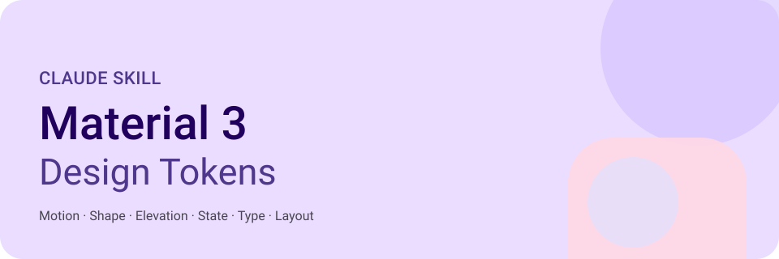
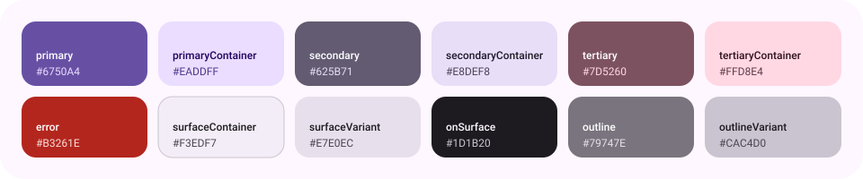
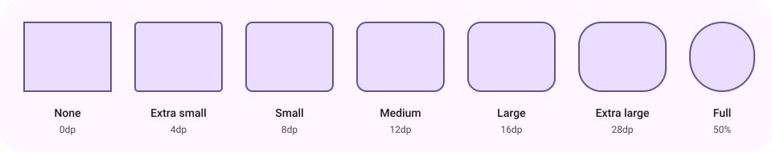
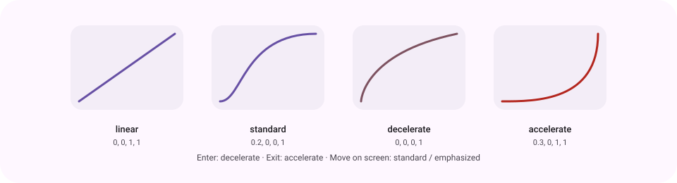

<div align="center">



<br/>


**Concrete M3 numbers for Claude. No guessing, no vibes.**

</div>

---

## What is this?

A [Claude skill](https://docs.claude.com) that gives Claude exact **Material Design 3** token values: motion, shape, elevation, state layers, typography, window size classes, layout and **component dimensions**. When you ask for CSS, Compose, Flutter or Android code that should "feel like Material", Claude uses real tokens instead of made-up numbers.

## Install

1. Download or clone this repo.
2. Zip the `material3-design-tokens/` folder and rename it to `material3-design-tokens.skill`.
3. Upload it in Claude: **Settings → Capabilities → Skills**.

Claude Code users can drop the folder straight into `~/.claude/skills/`:

```bash
git clone https://github.com/beyondbday69/material3-design-tokens
cp -r material3-design-tokens/material3-design-tokens ~/.claude/skills/
```

## Triggers

Claude loads the skill when you mention Material 3, Material You, M3 Expressive, `md.sys` tokens, Material easing, duration or spring values, or ask for Material-style values in CSS, Compose or Flutter.

---

## Tokens at a glance

### Color roles (baseline scheme)



> Color is not covered by the skill's data tables. For dynamic color and HCT, the skill tells Claude to look up m3.material.io and real implementations instead of inventing values.

### Shape



| Token | None | XS | S | M | L | XL | Full |
|---|---|---|---|---|---|---|---|
| Radius | 0 | 4 | 8 | 12 | 16 | 28 | 50% |

### Motion



| Duration | ms | Duration | ms |
|---|---|---|---|
| short1–4 | 50 / 100 / 150 / 200 | long1–4 | 450 / 500 / 550 / 600 |
| medium1–4 | 250 / 300 / 350 / 400 | extra-long1–4 | 700 / 800 / 900 / 1000 |

```css
--md-sys-motion-easing-standard: cubic-bezier(0.2, 0, 0, 1);
--md-sys-motion-easing-emphasized-decelerate: cubic-bezier(0.05, 0.7, 0.1, 1);
--md-sys-motion-easing-emphasized-accelerate: cubic-bezier(0.3, 0, 0.8, 0.15);
```

**Expressive springs**

| Spring | Stiffness | Damping | Use |
|---|---|---|---|
| spatial fast | 1400 | 0.9 | small position, size, shape changes |
| spatial default | 700 | 0.9 | most spatial motion |
| spatial slow | 300 | 0.9 | large, full-screen movement |
| effects fast | 3800 | 1.0 | quick color and opacity |
| effects default | 1600 | 1.0 | color and opacity |
| effects slow | 800 | 1.0 | gentle color and opacity |

### State layers and elevation

| State | Opacity | | Level | dp |
|---|---|---|---|---|
| Hover | 0.08 | | 0 | 0 |
| Focus | 0.10 | | 1 | 1 |
| Pressed | 0.10 | | 2 | 3 |
| Dragged | 0.16 | | 3 | 6 |
| Disabled | 0.38 content / 0.12 container | | 4 / 5 | 8 / 12 |

### Typography (size / line height, sp)

| Role | Large | Medium | Small |
|---|---|---|---|
| Display | 57/64 | 45/52 | 36/44 |
| Headline | 32/40 | 28/36 | 24/32 |
| Title | 22/28 | 16/24 | 14/20 |
| Body | 16/24 | 14/20 | 12/16 |
| Label | 14/20 | 12/16 | 11/16 |

### Window size classes and layout

| Class | Width (dp) |
|---|---|
| Compact | < 600 |
| Medium | 600–839 |
| Expanded | 840–1199 |
| Large | 1200–1599 |
| Extra-large | 1600+ |

Touch target **48×48dp** · Margins **16dp** compact, **24dp** larger · **4dp** base grid.

### Components

Heights, shapes and icon sizes for 50+ components (buttons, FABs, chips, cards, dialogs, sheets, menus, app bars, navigation, tabs, text fields, switch, slider, lists, pickers and more). A few examples:

| Component | Size | Shape | Icon |
|---|---|---|---|
| Button | 40 high | full | 18 |
| Chip | 32 high | small (8) | 18 |
| FAB / large FAB | 56 / 96 | large (16) / extra-large (28) | 24 / 36 |
| Card | content | medium (12) | 24 |
| Dialog | content | extra-large (28) | 24 |
| Navigation bar | 80 high, 64x32 indicator | full indicator | 24 |
| Top app bar | 64 / 112 / 152 | none | 24 |
| Text field | 56 | extra-small (4) | 24 |
| Switch | 52x32 track | full | 16 |

Full tables live in [`SKILL.md`](material3-design-tokens/SKILL.md). Values come from Material Web component tokens (v0.192).

---

## Repo layout

```
material3-design-tokens/
├── material3-design-tokens/
│   └── SKILL.md          # the skill itself
├── assets/               # README visuals (SVG)
└── README.md
```

## Accuracy note

Spring values and the `emphasized` curve come from implementations, not the JS-rendered spec. Verify against [m3.material.io](https://m3.material.io/styles/motion) when precision matters.

<div align="center">

<sub>Built with Material 3 colors · Unofficial, not affiliated with Google</sub>

</div>
